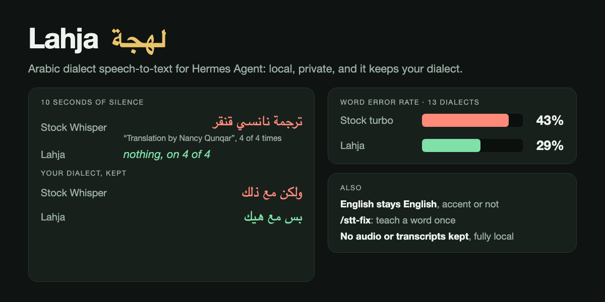

# Lahja (لهجة) — Arabic dialect speech-to-text for Hermes



Send Hermes a voice note in Levantine, Gulf, Egyptian, Iraqi or Maghrebi Arabic and get back **what you
actually said**: in your dialect, not rewritten as formal Arabic, and not translated.

Fully local. No API keys. Stores no audio and no transcripts.

```
voice note ─▶ ffmpeg 16 kHz ─▶ Silero VAD ─▶ dialect Whisper (whisper.cpp, Metal)
                                                  │ Arabic?             └─ not Arabic ─▶ stock Whisper
                                                  ▼
                              hallucination filter ─▶ your /stt-fix corrections ─▶ Hermes
```

## Why

Stock Whisper is weak on spoken Arabic, and it fails in ways an assistant cannot work with:

| Problem | Stock Whisper | Lahja |
|---|---|---|
| **Dialect** | rewrites it as formal Arabic: «بس مع هيك» → «ولكن مع ذلك», «ما بعرف» → «لا اعرف» | keeps it |
| **Meaning** | on a real Levantine voice note, «مالها طعمة» (*has no taste*) became «لها طعم ومعنى» (*has taste and meaning*) | correct |
| **Word error rate**, 13 dialects, same VAD and settings | 41.1 % | **29.1 %** |
| **English said with an Arabic accent** | often detected as Arabic and *translated* into Arabic | caught and transcribed as English |
| **Silence / noise** | without voice detection: «ترجمة نانسي قنقر» ("Translation by Nancy Qunqar") on 4 of 4 non-speech clips | VAD on by default, plus a filter for subtitle credits that slip through: empty on 4 of 4 |

The dialect and meaning examples come from stock large-v3 (language `auto`, with VAD) on real
voice notes. VAD alone also fixes the silence case for stock Whisper, and Hermes' built-in
faster-whisper provider already uses it; Lahja simply never runs without it.

### Numbers

`bench/run_bench.py` reproduces everything below with one command. Test audio: the 13 held-out
clips (one per dialect, 82 s) published on the dialect model's card, scored with diacritics and
punctuation removed and hamza / alef / ya / ta-marbuta variants folded. Both models: q5_0,
whisper.cpp 1.9.4, language `ar`, the same Silero VAD, Apple M4.

| Dialect | Stock large-v3-turbo | Lahja |
|---|---|---|
| Egyptian | 0.42 | **0.08** |
| Iraqi | 0.26 | **0.05** |
| Yemeni | 0.56 | **0.11** |
| Palestinian | 1.00 | **0.40** |
| Lebanese | 0.33 | **0.17** |
| Tunisian | 0.42 | **0.25** |
| Libyan | 0.43 | **0.29** |
| Moroccan | 0.62 | **0.50** |
| Sudanese | 0.31 | **0.25** |
| Saudi / Gulf | 0.30 | 0.30 |
| Bahraini | 0.10 | 0.10 |
| Syrian | **0.18** | 0.23 |
| Algerian | **0.67** | 0.87 |
| **All (word-weighted)** | **0.411** | **0.291** |

Stock without VAD (whisper.cpp's default) scores 0.429. 13 clips is a small sample; the model's own
card reports WER 0.332 on its 2,600-clip balanced test split (Gulf 0.17 … Tunisian 0.54). Speed is
the same as stock turbo: a typical 10–40 s voice note transcribes in 2–4 s on an M4, and silence
returns in under a second.

## Install

```bash
brew install whisper-cpp ffmpeg              # whisper-cli (Metal) and ffmpeg
hermes plugins install lahja --enable        # from the Hermes plugin catalog
hermes lahja setup                           # downloads the model (574 MB) + VAD (1 MB), SHA-256 verified
hermes config set stt.provider lahja
hermes lahja status                          # everything should say installed/found
```

To install straight from this repo instead (the plugin is the `lahja/` folder; copying it keeps
the plugin key `lahja` that the commands below use):

```bash
git clone https://github.com/Tarekkharsa/hermes-lahja && cp -R hermes-lahja/lahja ~/.hermes/plugins/lahja
hermes plugins enable lahja
```

Optional, recommended if you also send English (or any non-Arabic) voice notes: point Lahja at a
stock Whisper model for those. Either one you already have:

```bash
hermes config set plugins.entries.lahja.settings.other_languages_model ~/.cache/whisper/ggml-large-v3.bin
```

or Lahja's own copy of stock large-v3-turbo:

```bash
hermes lahja setup --model turbo-stock-q5
hermes config set plugins.entries.lahja.settings.other_languages_model turbo-stock-q5
```

Try it on any file without touching your config: `hermes lahja test note.ogg`.

To go back: `hermes config unset stt.provider` (Hermes auto-detects its built-in providers again),
or set your previous provider by name.

## Teach it once: `/stt-fix`

Names, places and English words inside Arabic speech are where every model struggles. Teach a
correction once and it applies to every later voice note:

```
/stt-fix جي إلي تي => JLT
/stt-fix بلغين => plugin
/stt-fix list
/stt-fix remove 2
```

Matching is on whole words and ignores diacritics, hamza seats and punctuation (quotes and
brackets around a replaced phrase are kept). A rule made of spelled-out letters (every word 1–3
letters, like «جي إلي تي» or "G L T") also matches the same letters spaced differently («جيإلي تي»,
«جيإليتي»); any other rule matches exactly its own words, so `/stt-fix مالك => Malek` never touches
«ما لك». No fuzzy guessing: a different spelling is a different correction. Rules never chain, and
up to 500 are kept.

Corrections belong to the Hermes profile: they apply to every chat, and anyone allowed to talk to
this Hermes (your gateway allowlist) can add one with `/stt-fix`. `/stt-fix list` shows them all.

## Languages: how Lahja decides

* **Arabic** (the common case) costs one pass: the dialect model detects the language and
  transcribes in the same run.
* **Another language** detected with confidence ≥ 0.5 is decoded again by `other_languages_model`,
  in that language.
* **English with an Arabic accent** is routinely *detected* as Arabic (on a real voice note: p = 0.99995
  from the dialect model, 0.82 from stock large-v3). The dialect model then writes it phonetically —
  «ذاتس لايك يو غايز… آي دونت نو». Lahja recognises that text (English function words written in
  Arabic letters; spellings that are real Arabic words such as «إي», «شي», «تو», «كان», «وانا» are
  never counted, nor dialect words like Gulf «ذا/ذي» "this" or Maghrebi «وي» "oui") and, when
  the note is *mostly* English (≥ 25 % of its words and ≥ 5 different markers), decodes it again
  as English. Across ~900 words of real Arabic voice notes, including code-switched ones, the check
  fired zero times; a real accented-English note scores 8 different markers.
* **Hints never force a language.** Whisper forced into a language the speaker is not using
  *translates* into it, and Hermes' own default hint is `stt.language: en`, so Lahja ignores
  non-Arabic hints and detects per note. The only time Lahja decodes in a language Whisper didn't
  detect is the mostly-English case above.
* **`ar` turns routing off.** If `stt.language` or this plugin's `language` setting is `ar`, every
  note is decoded as Arabic: no detection, no English check.
* **Routing is best-effort.** If `other_languages_model` is invalid, missing or fails, Lahja logs a
  warning and keeps the dialect model's text instead of failing the note.

## Settings

`plugins.entries.lahja.settings.<key>` in `config.yaml`:

| Key | Default | |
|---|---|---|
| `stt_model` | `turbo-dialectal-v2-q5` | model id from `hermes lahja models` |
| `language` | `auto` | `auto` (detect per note) or `ar` (always Arabic) |
| `other_languages_model` | *(empty)* | model id or absolute path to a ggml `.bin` for non-Arabic notes |
| `vad` | `true` | skip non-speech audio with Silero VAD |
| `hallucination_filter` | `true` | strip subtitle-credit hallucinations at the start/end of a transcript |
| `threads` | `4` | CPU threads for whisper.cpp |
| `timeout` | `300` | seconds one note may take in total, queueing included (30–3600) |
| `max_parallel` | `1` | notes decoded at the same time (1–4); each run loads its model into memory |

## Privacy and what this plugin does (disclosure)

* **Audio** is converted and decoded locally in a private temporary directory that is deleted when
  the call returns. Nothing is uploaded, ever.
* **Network:** only `hermes lahja setup`, which downloads the files listed in `lahja/models.py` from
  `huggingface.co` over HTTPS (redirected to its CDN, `*.cdn.hf.co` / `*.hf.co`). Each URL names an
  exact repository commit, each file has a SHA-256 and a size cap; a mismatch deletes the download
  and fails. The dialect model comes from a community ggml mirror (`JoaoZaokk/…-ggml`) of the
  official weights — see below for how to verify it. Transcription itself makes no network calls.
* **Subprocesses:** `ffmpeg` (allowed to read local files only: `-protocol_whitelist file,pipe`) and
  `whisper-cli`, with a fixed argument list (no shell), one overall deadline per note, at most
  `max_parallel` running at once, and a minimal environment (`PATH`, `LANG`, `LC_ALL`, `TMPDIR`,
  `LD_LIBRARY_PATH`) — never Hermes' environment, so no API key can reach them.
* **Files read:** the audio file Hermes hands to the provider, the model files in this plugin's data
  directory, and — only if you configure it — the `other_languages_model` file you point at.
* **Files written:** model files and your corrections (the two phrases of each `/stt-fix`, nothing
  else), both in this plugin's profile-scoped data directory. No audio, no transcripts, no logs of
  what you said.
* **Corrections are shared text substitution:** a `/stt-fix` rule rewrites matching words in every
  later transcript of the profile, and any user your gateway lets talk to Hermes can add one (rules
  with control or invisible characters are refused; each side ≤ 120 characters).
* **No** telemetry, credentials, background processes, hooks or tools. It registers one STT provider
  (`lahja`), one slash command (`/stt-fix`) and one CLI command (`hermes lahja`).

## The model, and how to verify it

Default model: **whisper-large-v3-turbo fine-tuned for 13 Arabic dialects** by
[oddadmix](https://huggingface.co/oddadmix/whisper-large-v3-turbo-arabic-dialectal-v2) (Apache-2.0),
in whisper.cpp q5_0 format. `hermes lahja setup` downloads a community ggml conversion; it is
**byte-identical** to a conversion of the official weights, which you can check yourself:

```bash
bench/convert.sh /tmp/lahja-convert     # official weights @ pinned revision → whisper.cpp 1.9.4 converter → q5_0
# … q5_0 sha256: 325b7dc691ac04174d91abbd58af74543236a146b87ea2f2f9ecfd9b260a9b6a
# MATCH: the downloaded model is byte-identical to this conversion of the official weights.
```

Every input (weights, converter, tokenizer files) is pinned to an exact commit; the script also
proves the tokenizer files it borrows from the base model are identical to the fine-tune's own.

## Known limits

* **English words inside Arabic sentences** come out phonetically («بلغين» for *plugin*); fix the
  ones you use with `/stt-fix`.
* **Numbers** are written as words («تلاتين فاصلة خمسة وأربعين»), not digits.
* **Brand and medicine names** are sometimes misspelled — again, `/stt-fix`.
* **Algerian** is worse than stock Whisper on the benchmark clip (0.87 vs 0.67), and Maghrebi
  dialects are the hardest for every model.
* **Apple Silicon or Linux with whisper.cpp.** Untested on Windows.

## Development

```bash
python3 -m pip install pytest
python3 -m pytest tests                       # 99 tests, no Hermes checkout needed
LAHJA_TEST_MODELS=<dir with the .bin files> python3 -m pytest tests   # + a real whisper.cpp run
hermes plugins validate ./lahja               # the catalog CI gate
```

## Credits and licenses

* Lahja: Apache-2.0 (this repository).
* Dialect model: [oddadmix/whisper-large-v3-turbo-arabic-dialectal-v2](https://huggingface.co/oddadmix/whisper-large-v3-turbo-arabic-dialectal-v2), Apache-2.0.
* [whisper.cpp](https://github.com/ggml-org/whisper.cpp) and [Silero VAD](https://github.com/snakers4/silero-vad), MIT.
* OpenAI Whisper large-v3 / large-v3-turbo, MIT.
